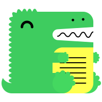

{/*
sidebar_position: 4

# Markdown Features

Docusaurus supports **[Markdown](https://daringfireball.net/projects/markdown/syntax)** and a few **additional features**.

## Front Matter

Markdown documents have metadata at the top called [Front Matter](https://jekyllrb.com/docs/front-matter/):

```text title="my-doc.md"
// highlight-start
---
id: my-doc-id
title: My document title
description: My document description
slug: /my-custom-url
---
// highlight-end

Markdown content
```

## Headings

Markdown headings are supported using the standard "#" syntax and are automatically added to the table of contents.

## Links

Regular Markdown links are supported, using url paths or relative file paths.

```md
Let's see how to [Create a page](/create-a-page).
```

## Images

Regular Markdown images are supported.

```md

```

## Code Blocks

Markdown code blocks are supported with Syntax highlighting.

## Admonitions

Docusaurus has a special syntax to create admonitions and callouts:

```md
:::tip[My tip]

Use this awesome feature option

:::

:::danger[Take care]

This action is dangerous

:::
```

## MDX and React Components

[MDX](https://mdxjs.com/) can make your documentation more **interactive** and allows using any **React components inside Markdown**.
*/}
